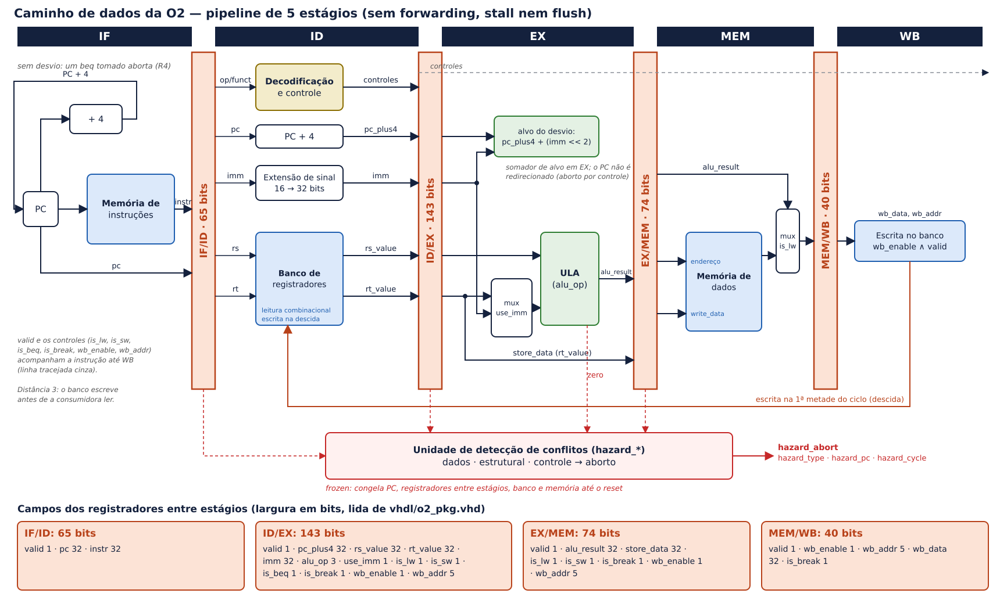
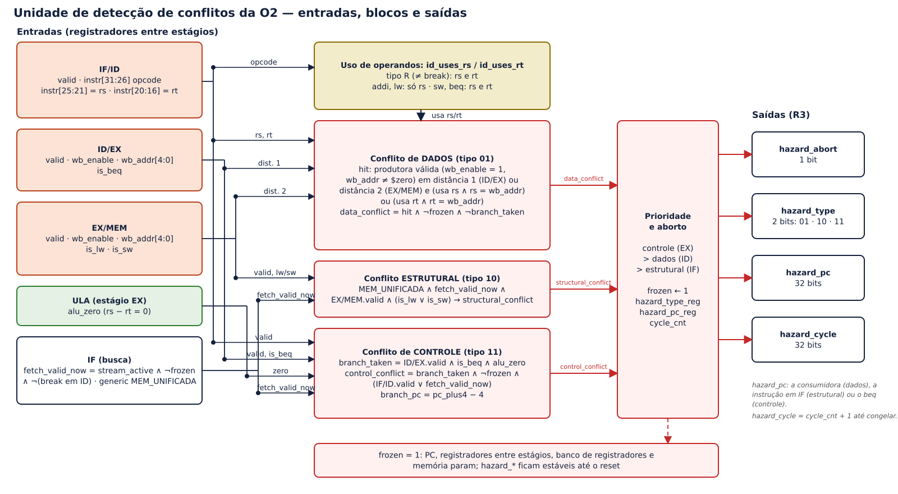

# Diagramas da O2: caminho de dados, unidade de detecção e registradores entre estágios

Gerados por `scripts/diagramas_o2.py` (`make diagramas-o2`) a partir de `vhdl/o2_pkg.vhd` e `vhdl/cpu_top_o2.vhd`: as larguras vêm dos tipos do pacote e o script falha se um sinal citado nas figuras não existir no código. Para a O1, o caminho de dados está em [`fsm-o1.md`](fsm-o1.md).

## 1. Caminho de dados da O2

- **IF:** o PC endereça a memória de instruções e alimenta um somador `+4`; `instr` e `pc` entram em IF/ID.
- **ID:** decodificação e controle (`idex_next`), leitura combinacional de `rs` e `rt`, extensão de sinal do imediato e `pc_plus4`; tudo entra em ID/EX.
- **EX:** a ULA opera `rs_value` com `rt_value` ou `imm` (mux `use_imm`); o somador calcula `pc_plus4 + (imm << 2)`. O `zero` da ULA vai para a detecção. O resultado e o `store_data` entram em EX/MEM.
- **MEM:** a memória de dados é acessada com `alu_result` (endereço) e `store_data`; um mux escolhe `mem_data` (lw) ou `alu_result` e grava `wb_data` em MEM/WB.
- **WB:** o banco é escrito com `wb_data` em `wb_addr`, quando `valid ∧ wb_enable`, **na 1ª metade do ciclo** (borda de descida); por isso uma consumidora em ID a distância 3 já lê o valor novo.
- Os controles (`is_lw`, `is_sw`, `wb_enable`, `wb_addr`, `is_break`) e o bit `valid` acompanham a instrução de registrador em registrador.

## 2. Unidade de detecção de conflitos

| Conflito | Condição (sinais do `cpu_top_o2.vhd`) | `hazard_type` | `hazard_pc` |
| --- | --- | :---: | --- |
| Dados | `id_uses_rs/rt` casa com `wb_addr` de produtora válida, `wb_enable = 1`, destino ≠ `$zero`, em ID/EX (distância 1) ou EX/MEM (distância 2) | `01` | a consumidora (ID) |
| Estrutural | `MEM_UNIFICADA ∧ fetch_valid_now ∧ EX/MEM.valid ∧ (is_lw ∨ is_sw)` | `10` | a instrução em IF (a mais nova) |
| Controle | `branch_taken` (`ID/EX.valid ∧ is_beq ∧ alu_zero`) com instrução já buscada em ID ou IF | `11` | o `beq` (`pc_plus4 − 4`) |

Quando mais de um conflito ocorre no mesmo ciclo, vale o da instrução mais antiga: controle > dados > estrutural. No ciclo da detecção `hazard_abort`, `hazard_type` e `hazard_pc` são combinacionais; na borda seguinte `frozen` vira 1 e tipo e PC são gravados em `hazard_type_reg` e `hazard_pc_reg`. `hazard_cycle` usa a convenção do `tb_cpu` (ciclo 1 = primeiro após o reset). As waveforms de detecção de cada traço estão em [`waveforms-aborto.md`](waveforms-aborto.md).

## 3. Registradores entre estágios: campos e larguras

Larguras em bits, lidas de `vhdl/o2_pkg.vhd`: `std_logic` = 1, `word_t` = 32, `reg_addr_t` = 5, `alu_operation_t` (5 operações) = 3.

### IF/ID (65 bits)

| Campo | Tipo VHDL | Bits | Descrição |
| --- | --- | ---: | --- |
| `valid` | `std_logic` | 1 | — |
| `pc` | `word_t` | 32 | — |
| `instr` | `word_t` | 32 | — |
| **Total** | | **65** | |

### ID/EX (143 bits)

| Campo | Tipo VHDL | Bits | Descrição |
| --- | --- | ---: | --- |
| `valid` | `std_logic` | 1 | — |
| `pc_plus4` | `word_t` | 32 | — |
| `rs_value` | `word_t` | 32 | — |
| `rt_value` | `word_t` | 32 | — |
| `imm` | `word_t` | 32 | imediato estendido por sinal |
| `alu_op` | `alu_operation_t` | 3 | — |
| `use_imm` | `std_logic` | 1 | '1' para I-type e lw/sw |
| `is_lw` | `std_logic` | 1 | — |
| `is_sw` | `std_logic` | 1 | — |
| `is_beq` | `std_logic` | 1 | — |
| `is_break` | `std_logic` | 1 | — |
| `wb_enable` | `std_logic` | 1 | — |
| `wb_addr` | `reg_addr_t` | 5 | — |
| **Total** | | **143** | |

### EX/MEM (74 bits)

| Campo | Tipo VHDL | Bits | Descrição |
| --- | --- | ---: | --- |
| `valid` | `std_logic` | 1 | — |
| `alu_result` | `word_t` | 32 | — |
| `store_data` | `word_t` | 32 | valor de rt para sw |
| `is_lw` | `std_logic` | 1 | — |
| `is_sw` | `std_logic` | 1 | — |
| `is_break` | `std_logic` | 1 | — |
| `wb_enable` | `std_logic` | 1 | — |
| `wb_addr` | `reg_addr_t` | 5 | — |
| **Total** | | **74** | |

### MEM/WB (40 bits)

| Campo | Tipo VHDL | Bits | Descrição |
| --- | --- | ---: | --- |
| `valid` | `std_logic` | 1 | — |
| `wb_enable` | `std_logic` | 1 | — |
| `wb_addr` | `reg_addr_t` | 5 | — |
| `wb_data` | `word_t` | 32 | — |
| `is_break` | `std_logic` | 1 | — |
| **Total** | | **40** | |

### Quais campos acompanham a instrução

| Campo | IF/ID | ID/EX | EX/MEM | MEM/WB |
| --- | :---: | :---: | :---: | :---: |
| `valid` | ✓ | ✓ | ✓ | ✓ |
| `pc` | ✓ |  |  |  |
| `instr` | ✓ |  |  |  |
| `pc_plus4` |  | ✓ |  |  |
| `rs_value` |  | ✓ |  |  |
| `rt_value` |  | ✓ |  |  |
| `imm` |  | ✓ |  |  |
| `alu_op` |  | ✓ |  |  |
| `use_imm` |  | ✓ |  |  |
| `is_lw` |  | ✓ | ✓ |  |
| `is_sw` |  | ✓ | ✓ |  |
| `is_beq` |  | ✓ |  |  |
| `is_break` |  | ✓ | ✓ | ✓ |
| `wb_enable` |  | ✓ | ✓ | ✓ |
| `wb_addr` |  | ✓ | ✓ | ✓ |
| `alu_result` |  |  | ✓ |  |
| `store_data` |  |  | ✓ |  |
| `wb_data` |  |  |  | ✓ |

Cada campo só segue adiante enquanto algum estágio posterior precisa dele: `store_data` termina em MEM, `imm` e `rs_value`/`rt_value` terminam em EX; `valid`, `wb_enable`, `wb_addr` e `is_break` chegam até WB. EX/MEM e MEM/WB não carregam o PC: nenhuma lógica posterior o usa.
