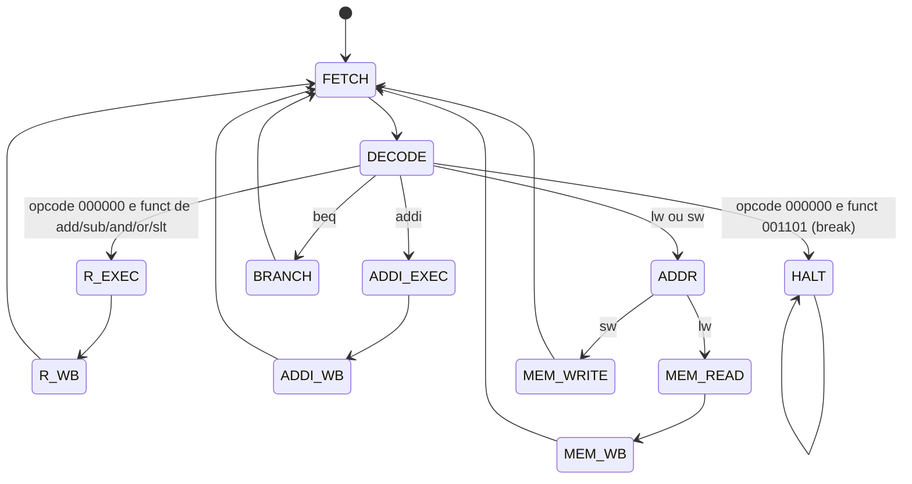

# FSM multiciclo da O1

> **Status:** especificação derivada da tabela ISA fornecida em `Tabela ISA - Página1.pdf`. A tabela define as instruções, codificações e operações descritas abaixo; detalhes de implementação do datapath que ela não especifica continuam identificados como premissas.

## 1. Premissas do datapath

- Dados, registradores, endereços e instruções têm 32 bits.
- O PC contém endereços em bytes; instruções e palavras são alinhadas em 4 bytes.
- Há memórias separadas: a memória de instruções recebe somente o PC e a memória de dados recebe somente o endereço efetivo calculado pela ALU.
- O banco tem 32 registradores, duas portas de leitura e uma de escrita. `$zero` lê zero e não aceita escrita.
- `IR` guarda a instrução; `A` e `B` guardam os operandos lidos; `ALUOut` guarda resultados intermediários; `MDR` guarda dados lidos da memória de dados.
- A leitura dos registradores é combinacional; `A`, `B`, `IR`, `ALUOut`, `MDR` e o PC atualizam na borda do clock quando habilitados.
- Cada acesso à memória ocupa um estado: a busca da instrução ocorre em `FETCH`, e leitura/escrita de dados ocorre em estado próprio.
- Os campos seguem os formatos MIPS da tabela: formato R com `opcode`, `rs`, `rt`, `rd`, `shamt` e `funct`; formato I com `opcode`, `rs`, `rt` e `imm16`. Os opcodes têm 6 bits e `funct` tem 6 bits; zeros à esquerda são preservados na comparação. O imediato é estendido com sinal.
- A tabela define as operações R `add`, `sub`, `and`, `or` e `slt`, além de `break`. As codificações dos campos `opcode` e `funct` são listadas na seção de decodificação.
- `slt` produz 1 quando `R[rs] < R[rt]` e 0 caso contrário. A tabela não especifica se a comparação é assinada; essa interpretação precisa ser confirmada antes de fixar a implementação da ALU.
- `beq` compara os operandos por subtração. Se forem iguais, o alvo é `PC + (signext(immediate) << 2)`. O PC usado já foi incrementado na busca.
- `break` entra em `HALT` e permanece nesse estado indefinidamente. O PC já foi incrementado durante `FETCH`.

### Caminhos de dados

1. **Busca:** `IR <- IMem[PC]` e `PC <- PC + 4`.
2. **Leitura de operandos/decodificação:** `A <- Reg[rs]`, `B <- Reg[rt]`. Em paralelo, a ALU calcula `PC + (signext(immediate) << 2)` e armazena em `ALUOut`; esse valor só é usado por `beq`.
3. **Execução R:** `ALUOut <- ALU(A, B, funct)`, com a operação determinada pela tabela de `funct`.
4. **Execução imediata:** `ALUOut <- A + signext(immediate)` para `addi`.
5. **Endereço efetivo:** `ALUOut <- A + signext(immediate)` para `lw` e `sw`.
6. **Acesso à memória de dados:** `MDR <- DMem[ALUOut]` para `lw`; `DMem[ALUOut] <- B` para `sw`.
7. **Branch:** se `A - B == 0`, `PC <- ALUOut`; caso contrário, o PC não muda.
8. **Write-back:** instrução R escreve `ALUOut` em `rd`; `addi` escreve `ALUOut` em `rt`; `lw` escreve `MDR` em `rt`.

### Decodificação da ISA

Os opcodes de `addi` e `beq` aparecem abreviados na tabela como `1000` e `100`. Como o campo `opcode` tem 6 bits no formato MIPS, são comparados com zeros à esquerda (`001000` e `000100`). A coluna `opcode / funct` da tabela define:

| Instrução | Formato | `opcode` (6 bits) | `funct` (6 bits) | Comportamento da ISA |
|---|---|---|---|---|
| `add rd, rs, rt` | R | `000000` | `100000` | `R[rd] <- R[rs] + R[rt]` |
| `sub rd, rs, rt` | R | `000000` | `100010` | `R[rd] <- R[rs] - R[rt]` |
| `and rd, rs, rt` | R | `000000` | `100100` | `R[rd] <- R[rs] AND R[rt]` |
| `or rd, rs, rt` | R | `000000` | `100101` | `R[rd] <- R[rs] OR R[rt]` |
| `slt rd, rs, rt` | R | `000000` | `101010` | `R[rd] <- (R[rs] < R[rt]) ? 1 : 0` |
| `break` | R | `000000` | `001101` | Fim de programa; congela o processador |
| `addi rt, rs, imm16` | I | `001000` | — | `R[rt] <- R[rs] + sign_ext(imm16)` |
| `lw rt, offset(rs)` | I | `100011` | — | `R[rt] <- MEM[R[rs] + sign_ext(imm16)]` |
| `sw rt, offset(rs)` | I | `101011` | — | `MEM[R[rs] + sign_ext(imm16)] <- R[rt]` |
| `beq rs, rt, offset` | I | `000100` | — | Se `R[rs] == R[rt]`, `PC <- PC + 4 + (sign_ext(imm16) << 2)` |

Para o formato R, a unidade de controle reconhece `break` pelo `funct=001101`; os outros cinco `funct` listados selecionam execução R e write-back em `rd`. Outras combinações não estão definidas pela tabela ISA.

## 2. Sinais de controle

Controles não listados como ativos ou com valor explícito na tabela de estados ficam inativos (`0`). O sinal `MemRead` se refere exclusivamente à memória de dados; a leitura de instruções é selecionada pelo estado `FETCH` e usa o PC. Não há seleção de endereço entre memórias.

| Sinal | Significado |
|---|---|
| `IRWrite`, `AWrite`, `BWrite`, `ALUOutWrite`, `MDRWrite` | Habilitam a escrita nos registradores internos correspondentes. |
| `RegWrite` | Habilita escrita no banco de registradores; escrita em `$zero` é descartada. |
| `RegDst` | `rd` se `1`; `rt` se `0`. |
| `MemToReg` | Dado de escrita: `ALUOut` se `0`; `MDR` se `1`. |
| `MemRead`, `MemWrite` | Leitura ou escrita da memória de dados. |
| `ALUSrcA` | Operando A da ALU: `PC` se `0`; registrador temporário `A` se `1`. |
| `ALUSrcB` | Operando B da ALU: `B` se `00`; constante `4` se `01`; imediato estendido com sinal se `10`; imediato estendido e deslocado 2 bits se `11`. |
| `ALUControl` | `ADD`, `SUB`, `AND`, `OR` ou `SLT`; em `R_EXEC`, a operação é determinada pelo `funct` da tabela ISA. |
| `PCWrite` | Atualiza o PC incondicionalmente. |
| `PCWriteCond` | Atualiza o PC somente se a condição da ALU (`Zero`) for verdadeira. |
| `PCSource` | `ALU` se `0`; `ALUOut` se `1`. |

## 3. Estados e transições

Cada estado ocupa um ciclo. A transição ocorre na borda final do ciclo, junto com as escritas habilitadas. `FETCH` é o estado inicial.

Instruções/codificações não cobertas pela tabela ISA não têm comportamento definido aqui; o tratamento de instruções inválidas depende da implementação.

## 4. Quadro de sinais por estado

As atribuições da coluna **Controles ativos/seleções** são os únicos controles assertados ou selecionados naquele estado; os demais permanecem inativos. `RegDst` e `MemToReg` são seleções do caminho de escrita e só têm efeito quando `RegWrite=1`.

| Estado | Controles ativos/seleções | Ação no ciclo | Próximo estado |
|---|---|---|---|
| `FETCH` | `IRWrite=1`, `PCWrite=1`, `PCSource=ALU`, `ALUSrcA=PC`, `ALUSrcB=4`, `ALUControl=ADD` | `IR <- IMem[PC]`; `PC <- PC + 4` | `DECODE` |
| `DECODE` | `AWrite=1`, `BWrite=1`, `ALUOutWrite=1`, `ALUSrcA=PC`, `ALUSrcB=imm<<2`, `ALUControl=ADD` | `A <- Reg[rs]`; `B <- Reg[rt]`; `ALUOut <- PC + (signext(imm16)<<2)` | `R_EXEC` para `opcode=000000` e `funct` de `add/sub/and/or/slt`; `ADDI_EXEC` para `opcode=001000`; `ADDR` para `opcode=100011` (`lw`) ou `101011` (`sw`); `BRANCH` para `opcode=000100`; `HALT` para `opcode=000000` e `funct=001101` (`break`) |
| `R_EXEC` | `ALUOutWrite=1`, `ALUSrcA=A`, `ALUSrcB=B`, `ALUControl=FUNCT` | `ALUOut <- ALU(A, B, funct)`: `100000` ADD, `100010` SUB, `100100` AND, `100101` OR, `101010` SLT | `R_WB` |
| `R_WB` | `RegWrite=1`, `RegDst=rd`, `MemToReg=ALUOut` | `Reg[rd] <- ALUOut` | `FETCH` |
| `ADDI_EXEC` | `ALUOutWrite=1`, `ALUSrcA=A`, `ALUSrcB=imm`, `ALUControl=ADD` | `ALUOut <- A + signext(immediate)` | `ADDI_WB` |
| `ADDI_WB` | `RegWrite=1`, `RegDst=rt`, `MemToReg=ALUOut` | `Reg[rt] <- ALUOut` | `FETCH` |
| `ADDR` | `ALUOutWrite=1`, `ALUSrcA=A`, `ALUSrcB=imm`, `ALUControl=ADD` | `ALUOut <- A + signext(immediate)` | `MEM_READ` para `lw`; `MEM_WRITE` para `sw` |
| `MEM_READ` | `MemRead=1`, `MDRWrite=1` | `MDR <- DMem[ALUOut]` | `MEM_WB` |
| `MEM_WB` | `RegWrite=1`, `RegDst=rt`, `MemToReg=MDR` | `Reg[rt] <- MDR` | `FETCH` |
| `MEM_WRITE` | `MemWrite=1` | `DMem[ALUOut] <- B` | `FETCH` |
| `BRANCH` | `PCWriteCond=1`, `PCSource=ALUOut`, `ALUSrcA=A`, `ALUSrcB=B`, `ALUControl=SUB` | Se `Zero=1`, `PC <- ALUOut`; se `Zero=0`, PC permanece inalterado | `FETCH` |
| `HALT` | Nenhum | Mantém PC, banco e memórias sem escrita; a execução permanece parada | `HALT` |

`ALUSrcA=PC`/`A` e `ALUSrcB=4`/`imm`/`imm<<2` são rótulos simbólicos dos valores definidos na tabela de sinais; suas codificações físicas dependem da implementação.

## 5. Ciclos por classe

Contagem por instrução, incluindo a busca e a decodificação. Cada estado conta um ciclo; os acessos às memórias de instruções e de dados têm a latência de um estado conforme as premissas acima.

| Classe | Caminho de estados | Ciclos |
|---|---|---:|
| R (`add`, `sub`, `and`, `or`, `slt`) | `FETCH -> DECODE -> R_EXEC -> R_WB` | 4 |
| `addi` | `FETCH -> DECODE -> ADDI_EXEC -> ADDI_WB` | 4 |
| `lw` | `FETCH -> DECODE -> ADDR -> MEM_READ -> MEM_WB` | 5 |
| `sw` | `FETCH -> DECODE -> ADDR -> MEM_WRITE` | 4 |
| `beq` tomado | `FETCH -> DECODE -> BRANCH` | 3 |
| `beq` não tomado | `FETCH -> DECODE -> BRANCH` | 3 |
| `break` | `FETCH -> DECODE -> HALT` | 3 até entrar no estado de parada |

Depois de `break`, `HALT` se repete a cada ciclo; portanto, 3 ciclos é a latência até a entrada na parada, não uma contagem finita da permanência parada.

## 6. Verificação dos critérios do issue

- A FSM cobre instruções R, `addi`, `lw`, `sw`, `beq` e `break`.
- Os sinais de controle e suas seleções estão relacionados por estado.
- A contagem foi derivada dos estados percorridos, incluindo ambos os resultados de `beq`.
- Memórias de instruções e dados têm caminhos de endereço distintos; `IorD` não é um sinal de controle da FSM.
