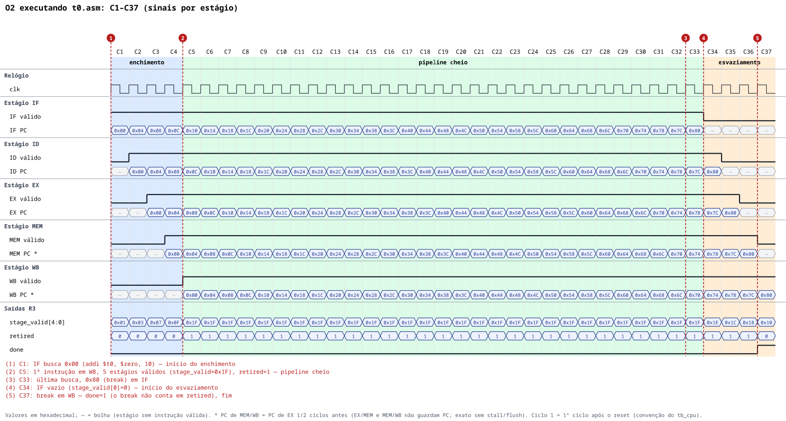
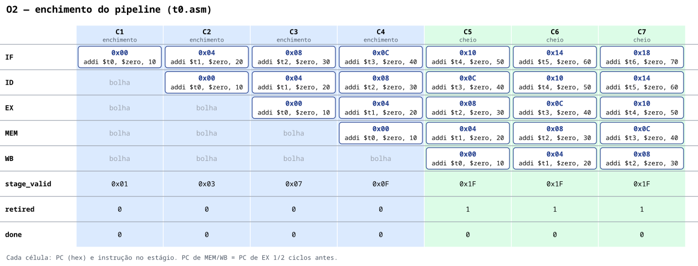
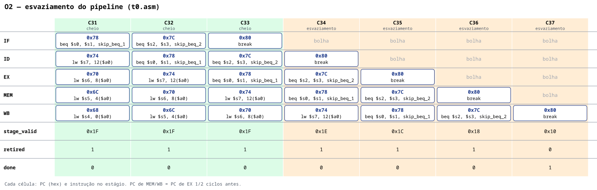

# Execução do T0 na O2: waveform anotada (issue #17)

Gerada a partir da simulação real (`make wave-t0`): o `tb_cpu` roda o T0 na O2 com dump GHW e o
`scripts/waveform_o2.py` lê o dump, amostra cada ciclo na borda de descida (mesma convenção do
`tb_cpu`: ciclo 1 = primeiro ciclo após o reset) e desenha as figuras. Nenhum ciclo ou valor é
escrito à mão: as fases e os marcadores são calculados a partir dos bits de validade.

## Waveform completa (C1–C37)



Sinais agrupados por estágio (IF, ID, EX, MEM, WB) com bit de validade e PC em hexadecimal, mais as
saídas R3 (`stage_valid[4:0]`, `retired`, `done`).

| Marcador | Ciclo | O que acontece |
| --- | --- | --- |
| 1 | C1 | IF busca `0x00` (`addi $t0, $zero, 10`): início do **enchimento**; `stage_valid = 0x01` |
| 2 | C5 | a 1ª instrução chega a WB: os 5 estágios estão válidos (`stage_valid = 0x1F`), `retired = 1`: **pipeline cheio** |
| 3 | C33 | última busca: o `break` (`0x80`) está em IF |
| 4 | C34 | IF fica vazio (`stage_valid[0] = 0`): início do **esvaziamento** |
| 5 | C37 | o `break` chega a WB: `done = 1`; o `break` não conta em `retired` |

- **Enchimento (C1–C4):** `stage_valid` = `0x01 → 0x03 → 0x07 → 0x0F`, um estágio a mais por ciclo;
  `retired = 0` porque nenhuma instrução chegou a WB.
- **Pipeline cheio (C5–C33):** `stage_valid = 0x1F` e uma instrução concluída por ciclo (`retired = 1`).
- **Esvaziamento (C34–C37):** depois do `break` não há mais buscas; `stage_valid` =
  `0x1E → 0x1C → 0x18 → 0x10`, um estágio a menos por ciclo, até o `break` concluir em WB.
- **Total:** 37 ciclos para 32 instruções úteis = 33 instruções (com o `break`) + 4 ciclos de enchimento.

## Detalhe do enchimento e do esvaziamento

Cada célula mostra o PC (hex) e a instrução que está no estágio naquele ciclo.





## No GTKWave (defesa)

```bash
make wave-t0
gtkwave build/t0_o2.ghw docs/waveforms/t0_o2.gtkw
```

A sessão abre com os sinais agrupados por estágio (registradores IF/ID, ID/EX, EX/MEM e MEM/WB),
barramentos em hexadecimal e os marcadores nomeados **A–E** nos mesmos ciclos da tabela acima.
O eixo do GTKWave é em tempo: o ciclo *k* vai de `15 + 10(k−1)` ns a `15 + 10k` ns.

## Arquivos

| Arquivo | Conteúdo |
| --- | --- |
| `waveforms/t0_o2_completo.{svg,png}` | waveform C1–C37 com fases e marcadores |
| `waveforms/t0_o2_enchimento.{svg,png}` | zoom C1–C7 |
| `waveforms/t0_o2_esvaziamento.{svg,png}` | zoom C31–C37 |
| `waveforms/t0_o2_ciclos.csv` | PC de cada estágio, `stage_valid`, `retired` e `done` por ciclo |
| `waveforms/t0_o2.gtkw` | sessão do GTKWave |

**Observação:** os registradores EX/MEM e MEM/WB não guardam o PC no RTL. Nas figuras, o PC de MEM
e de WB é o PC que estava em EX um e dois ciclos antes. Isso é exato na O2, que não tem stall nem
flush. No GTKWave, MEM mostra `alu_result` e WB mostra o registrador e o dado escritos.
