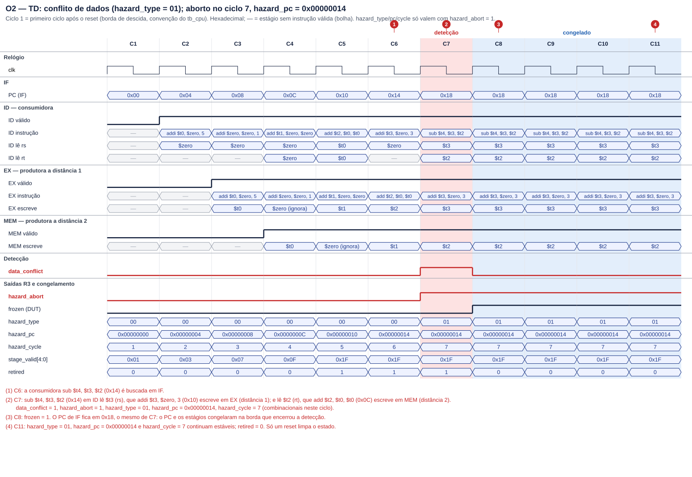
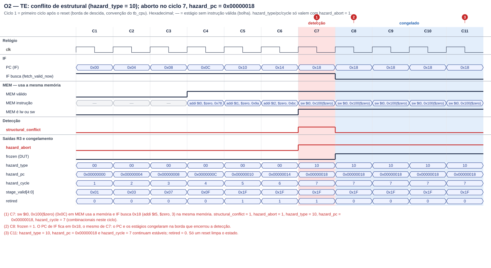
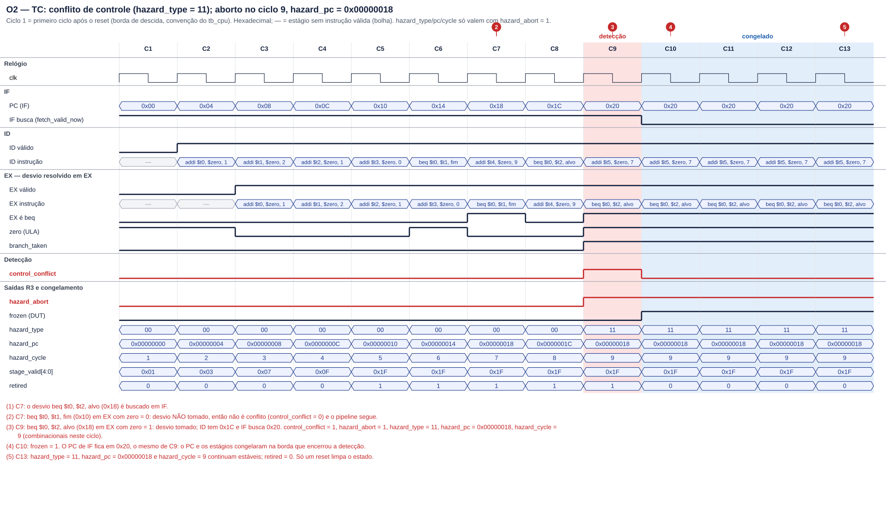

# Waveforms de detecção e aborto: TD, TE e TC na O2

Uma waveform por tipo de conflito, geradas por `make wave-aborto` (`scripts/waveform_aborto.py`) a partir
da simulação real. Cada figura vai de C1 até 4 ciclos depois do aborto e traz, agrupados por estágio, os
**campos que disparam a detecção**, o sinal de detecção, `hazard_abort`, `frozen` e o PC de IF, com
marcadores numerados nos ciclos exatos. Ciclo 1 = primeiro ciclo após o reset (borda de descida, convenção
do `tb_cpu`); valores em hexadecimal; `—` = estágio sem instrução válida (bolha).

**Como ler:** a coluna vermelha é o ciclo da detecção, em que `hazard_abort` e o tipo aparecem de forma
combinacional; as colunas azuis são o estado congelado (`frozen = 1`). `hazard_type`, `hazard_pc` e
`hazard_cycle` só têm significado com `hazard_abort = 1`; antes disso mostram o valor que o circuito
produz (o PC corrente e a contagem de ciclos).

## TD — conflito de dados (tipo 01)



- **C7 (detecção):** o `sub $t4, $t3, $t2` (`0x14`) está em ID e lê **dois** registradores ainda não
  escritas: `$t3` (rs), que o `addi` de `0x10` produz em EX (**distância 1**), e `$t2` (rt), que o `add`
  de `0x0C` ainda tem em MEM (**distância 2**). `data_conflict = 1`, `hazard_type = 01`,
  `hazard_pc = 0x14` (a consumidora, uma só), `hazard_cycle = 7`.
- **Antes do aborto não há falso alarme:** em C4, `addi $zero, $zero, 1` aparece em EX escrevendo `$zero`
  (ignorado, não gera dependência), e em C5 o `add $t2, $t0, $t0` lê `$t0` a **distância 3**, sem
  conflito, porque o banco escreve na 1ª metade do ciclo e lê na 2ª.
- **C8:** `frozen = 1` e o PC de IF fica em `0x18`, o mesmo de C7.

## TE — conflito estrutural (tipo 10, `MEM_UNIFICADA = true`)



- **C7 (detecção):** o `sw $t0, 0x100($zero)` (`0x0C`) está em MEM, usando a memória única, e IF tenta
  buscar `0x18` na mesma memória. `structural_conflict = 1`, `hazard_type = 10`, `hazard_pc = 0x18` (a
  instrução **mais nova**, em IF, que não obteve o recurso), `hazard_cycle = 7`.
- Em C4 a C6 MEM só executa `addi` (não usa a memória de dados), e por isso não há conflito.
- **C8:** `frozen = 1`; o `sw` completou o acesso e a busca de `0x18` foi abortada.

## TC — conflito de controle (tipo 11)



- **C7 (sem conflito):** o `beq $t0, $t1, fim` (`0x10`) está em EX com `zero = 0`: **desvio não tomado,
  não é conflito**, e o pipeline segue.
- **C9 (detecção):** o `beq $t0, $t2, alvo` (`0x18`) está em EX com `zero = 1`: desvio tomado. ID já tem
  `0x1C` e IF busca `0x20`, instruções do caminho errado que, sem flush, seriam executadas.
  `branch_taken = 1`, `control_conflict = 1`, `hazard_type = 11`, `hazard_pc = 0x18` (o desvio),
  `hazard_cycle = 9`.
- **C10:** `frozen = 1` e o PC de IF fica em `0x20`.

## Congelamento (R4)

No ciclo seguinte à detecção `frozen` vira 1: PC, registradores entre estágios, banco e memória param.
`hazard_type`, `hazard_pc`, `hazard_cycle`, `stage_valid` e o PC ficam estáveis e `retired = 0` até o reset.
Se mais de um conflito coincidir no mesmo ciclo, vale o da instrução mais antiga: controle > dados >
estrutural.

## Como as figuras são conferidas

O script reproduz a detecção a partir dos campos amostrados (registradores lidos e escritos, `valid`,
`wb_enable`, `is_lw`, `is_sw`, `is_beq`, `zero`) e exige que ela **coincida com o sinal do hardware em
todos os ciclos até o aborto**; também exige `hazard_*`, PC e estágios estáveis nos 4 ciclos seguintes e
`retired = 0`. O texto dos marcadores é montado dos valores amostrados, sem números digitados à mão.

## No GTKWave

```bash
make wave-aborto
gtkwave build/td_o2.ghw docs/waveforms/td_aborto.gtkw     # ou te / tc
```

As sessões trazem os mesmos grupos e marcadores nomeados (A, B, C...) nos ciclos da figura. O eixo do
GTKWave é em tempo: o ciclo *k* vai de `15 + 10(k−1)` ns a `15 + 10k` ns.

| Arquivo | Conteúdo |
| --- | --- |
| `waveforms/<traço>_aborto.svg` e `.png` | a figura |
| `waveforms/<traço>_aborto.csv` | PC de cada estágio, sinais de detecção e `hazard_*`, ciclo a ciclo |
| `waveforms/<traço>_aborto.gtkw` | sessão do GTKWave |
